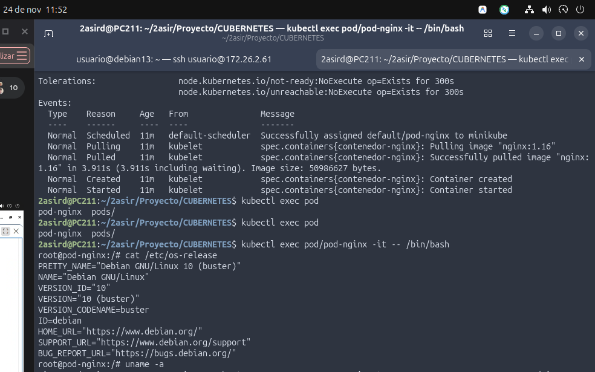
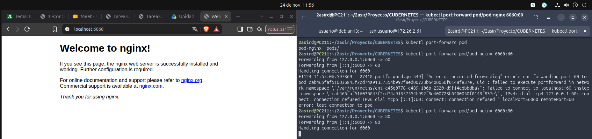
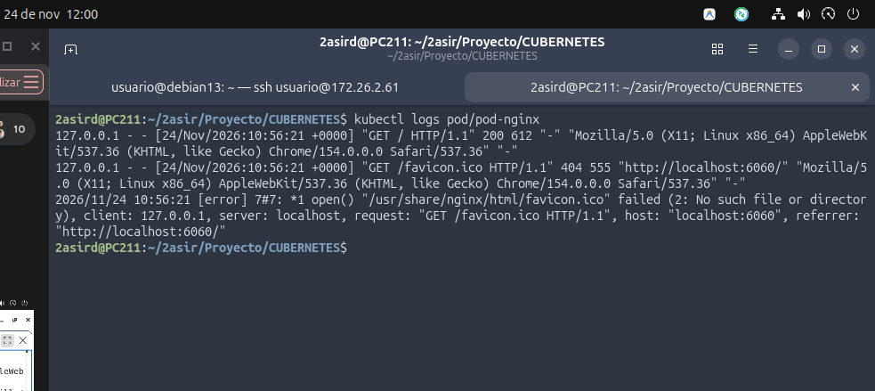

# Pods - Inspección, acceso, port-forward y logs de un Pod

Comandos ejecutados para trabajar con el Pod `pod-nginx` definido en [pod.yaml](pod.yaml).

## 1. Listar recursos y describir el Pod (`describe.png`)

```bash
kubectl get all
kubectl describe pod/pod-nginx
```


## 2. Consola interactiva dentro del Pod (`bash-iterativa.png`)

```bash
kubectl exec pod/pod-nginx -it -- /bin/bash
```

Comandos ejecutados dentro del contenedor:

```bash
cat /etc/os-release
uname -a
```



## 3. Redirección de puertos / Port-forward (`pasarela.png`)

```bash
kubectl port-forward pod/pod-nginx 6060:80
```

Acceso desde el navegador en `http://localhost:6060`.



## 4. Consulta de logs del Pod (`logs.png`)

```bash
kubectl logs pod/pod-nginx
```


