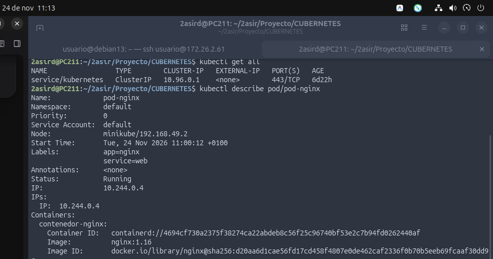

# Pods - Inspección, acceso, port-forward y logs de un Pod

Documentación de los comandos ejecutados sobre el Pod `pod-nginx` definido en [pod.yaml](pod.yaml), con su explicación y captura correspondiente.

---

## 1. Listar recursos y describir el Pod

```bash
kubectl get all
kubectl describe pod/pod-nginx
```

**Explicación:**
- `kubectl get all`: Lista todos los recursos principales activos en el namespace actual (`default`), mostrando en la captura el servicio `service/kubernetes`.
- `kubectl describe pod/pod-nginx`: Muestra la información detallada del Pod `pod-nginx`: namespace (`default`), nodo donde se ejecuta (`minikube`), etiquetas (`app=nginx`, `service=web`), estado (`Running`), IP interna (`10.244.0.4`) y datos del contenedor `contenedor-nginx` (`nginx:1.16`).



---

## 2. Consola interactiva dentro del Pod

```bash
kubectl exec pod/pod-nginx -it -- /bin/bash
```

Comandos ejecutados dentro del contenedor:

```bash
cat /etc/os-release
uname -a
```

**Explicación:**
- `kubectl exec pod/pod-nginx -it -- /bin/bash`: Abre una sesión interactiva de terminal (`-i` mantiene la entrada estándar y `-t` asigna una pseudo-TTY) ejecutando `/bin/bash` dentro del contenedor del Pod `pod-nginx`.
- `cat /etc/os-release`: Muestra la información de la distribución Linux del contenedor (`Debian GNU/Linux 10 (buster)`).
- `uname -a`: Muestra la información del kernel y la arquitectura del sistema desde dentro del contenedor.


---

## 3. Redirección de puertos (`port-forward`)

```bash
kubectl port-forward pod/pod-nginx 6060:60
kubectl port-forward pod/pod-nginx 6060:80
```

**Explicación:**
- `kubectl port-forward pod/pod-nginx 6060:60`: Primer intento de redirección del puerto local `6060` al puerto `60` del Pod; falla con `connection refused` porque Nginx no escucha en el puerto `60`.
- `kubectl port-forward pod/pod-nginx 6060:80`: Redirige correctamente el puerto local `6060` al puerto `80` del Pod `pod-nginx`, permitiendo acceder a la página de bienvenida de Nginx (`Welcome to nginx!`) desde el navegador en `http://localhost:6060`.


---

## 4. Consulta de logs del Pod

```bash
kubectl logs pod/pod-nginx
```

**Explicación:**
- `kubectl logs pod/pod-nginx`: Muestra la salida estándar y de error generada por el servidor Nginx dentro del Pod `pod-nginx`. En la captura se observan las peticiones recibidas desde `localhost:6060`: `GET /` con código HTTP `200` y `GET /favicon.ico` con código HTTP `404` (junto con el mensaje de error por no existir el archivo `favicon.ico`).


