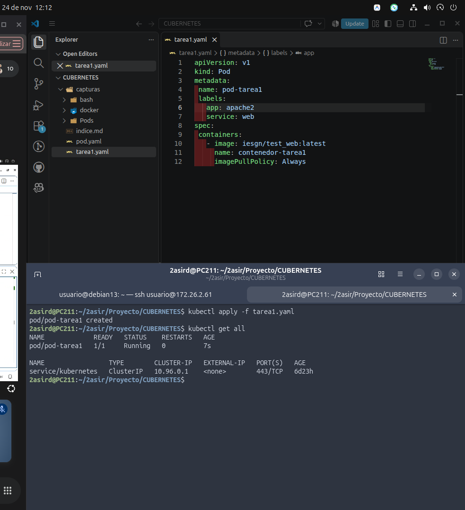
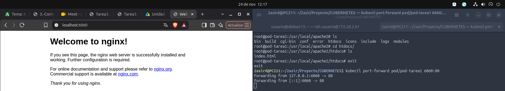
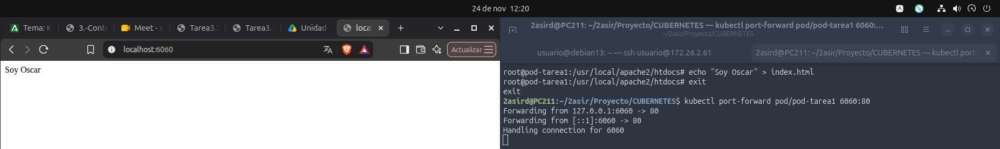

# Ejercicios y Tareas de Pods en Kubernetes

---

## Tarea 1: Despliegue de `pod-tarea1`, acceso al contenedor y personalización web

Manifiesto utilizado: [tarea1.yaml](tarea1.yaml)

### 1. Creación y comprobación del Pod

```bash
kubectl apply -f tarea1.yaml
kubectl get all
```

**Explicación:**
- `kubectl apply -f tarea1.yaml`: Crea o actualiza los recursos definidos en [tarea1.yaml](tarea1.yaml), desplegando el Pod `pod-tarea1` con la imagen `iesgn/test_web:latest` y el contenedor `contenedor-tarea1`.
- `kubectl get all`: Lista los recursos activos en el namespace `default`, verificando que `pod/pod-tarea1` aparece con `READY 1/1` y estado `Running`.



### 2. Comprobación de `htdocs` y redirección de puertos (`port-forward`)

Dentro del contenedor (`root@pod-tarea1:/usr/local/apache2#`):

```bash
ls
cd htdocs/
ls
exit
```

En el equipo local:

```bash
kubectl port-forward pod/pod-tarea1 6060:80
```

**Explicación:**
- `ls` y `cd htdocs/`: Permiten localizar el directorio raíz del servidor web Apache2 (`/usr/local/apache2/htdocs`) y comprobar que contiene el archivo `index.html`.
- `exit`: Cierra la sesión interactiva dentro del contenedor para volver a la terminal del host.
- `kubectl port-forward pod/pod-tarea1 6060:80`: Crea un túnel desde el puerto local `6060` hacia el puerto `80` del Pod `pod-tarea1` para poder consultar el servidor web desde `http://localhost:6060`.



### 3. Modificación de `index.html` y verificación en el navegador

Dentro del contenedor (`root@pod-tarea1:/usr/local/apache2/htdocs#`):

```bash
echo "Soy Oscar" > index.html
exit
```

En el equipo local:

```bash
kubectl port-forward pod/pod-tarea1 6060:80
```

**Explicación:**
- `echo "Soy Oscar" > index.html`: Sobrescribe el contenido de `index.html` dentro del directorio `htdocs` del contenedor con el texto `"Soy Oscar"`.
- `exit`: Sale de la shell del contenedor.
- `kubectl port-forward pod/pod-tarea1 6060:80`: Vuelve a exponer el puerto `80` del Pod en `localhost:6060`, mostrando en el navegador el nuevo contenido `Soy Oscar`.



---

## Ejercicios propuestos

### Ejercicio 1: Despliegue, inspección y acceso interactivo a un Pod

1. Crea un archivo llamado `pod-apache.yaml` que defina un Pod con las siguientes características:
   - **Nombre del Pod**: `pod-apache`
   - **Etiquetas (`labels`)**: `app: apache` y `entorno: practicas`
   - **Contenedor**: nombre `contenedor-apache`, imagen `httpd:2.4` y `imagePullPolicy: IfNotPresent`.
2. Aplica el manifiesto en el clúster con `kubectl apply`.
3. Comprueba que el Pod está en estado `Running` y muestra sus detalles completos (`kubectl get` y `kubectl describe`).
4. Accede de forma interactiva al contenedor con `/bin/bash`, comprueba la versión del sistema operativo (`/etc/os-release`) y verifica que el proceso de Apache está en ejecución.

### Ejercicio 2: Redirección de puertos (`port-forward`) y análisis de logs

1. Partiendo del Pod `pod-nginx` definido en [pod.yaml](pod.yaml) (o del Pod del ejercicio anterior):
   - Inicia una redirección de puertos para exponer el puerto `80` del Pod en el puerto local `8080` de tu máquina.
2. Abre un navegador (o usa `curl`) y realiza al menos dos peticiones:
   - Una a la ruta principal `/` (`http://localhost:8080/`).
   - Otra a una ruta inexistente, por ejemplo `/no-existe` (`http://localhost:8080/no-existe`).
3. Detén la redirección de puertos y consulta los logs del Pod con `kubectl logs`.
4. Identifica en la salida de los logs los códigos de estado HTTP (`200` y `404`) correspondientes a las peticiones realizadas.
