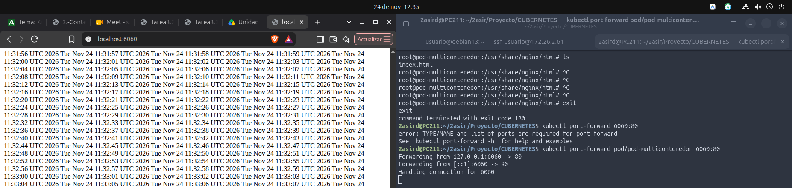

# Tarea 2: Pod multicontenedor con volumen compartido (`emptyDir`)

En esta tarea se trabaja con un Pod que ejecuta **dos contenedores** compartiendo un mismo volumen `emptyDir`, definido en [pod_multicontenedor.yaml](pod_multicontenedor.yaml):

- **`contenedor1`** (`nginx`): monta el volumen `html` en `/usr/share/nginx/html`.
- **`contenedor2`** (`debian`): monta el mismo volumen `html` en `/html` y ejecuta un bucle que escribe la fecha actual cada segundo en `/html/index.html`.

---

## 1. Despliegue y comprobación del Pod multicontenedor

```bash
kubectl apply -f pod_multicontenedor.yaml
kubectl get pods
kubectl describe pod/pod-multicontenedor
```

**Explicación:**
- `kubectl apply -f pod_multicontenedor.yaml`: Crea el Pod `pod-multicontenedor` con sus dos contenedores y el volumen compartido `html`.
- `kubectl get pods`: Muestra el estado del Pod (`READY 2/2` cuando ambos contenedores están listos).
- `kubectl describe pod/pod-multicontenedor`: Muestra los detalles de ambos contenedores (`contenedor1` y `contenedor2`), el volumen `emptyDir` y los eventos de arranque.

---

## 2. Acceso al contenedor, comprobación de `index.html` y redirección de puertos (`port-forward`)

Dentro de `contenedor1` (`root@pod-multicontenedor:/usr/share/nginx/html#`):

```bash
ls
exit
```

En el equipo local:

```bash
kubectl port-forward 6060:80
kubectl port-forward pod/pod-multicontenedor 6060:80
```

**Explicación:**
- `ls`: Comprueba dentro de `/usr/share/nginx/html` que existe `index.html`, creado y actualizado por `contenedor2` a través del volumen compartido `html`.
- `exit`: Cierra la sesión interactiva en el contenedor para volver a la terminal del host.
- `kubectl port-forward 6060:80`: Primer intento incompleto; `kubectl` devuelve un error indicando que es obligatorio especificar el recurso (`TYPE/NAME`).
- `kubectl port-forward pod/pod-multicontenedor 6060:80`: Redirige el puerto local `6060` al puerto `80` del Pod `pod-multicontenedor`. Al abrir `http://localhost:6060` en el navegador se visualizan las líneas de fecha y hora (`date`) que `contenedor2` va añadiendo cada segundo a `index.html`.



---

## 3. Consulta de logs de un contenedor específico

```bash
kubectl logs pod/pod-multicontenedor -c contenedor1
```

**Explicación:**
- `kubectl logs` con `-c contenedor1` muestra únicamente los registros de acceso y error generados por Nginx en `contenedor1`.
